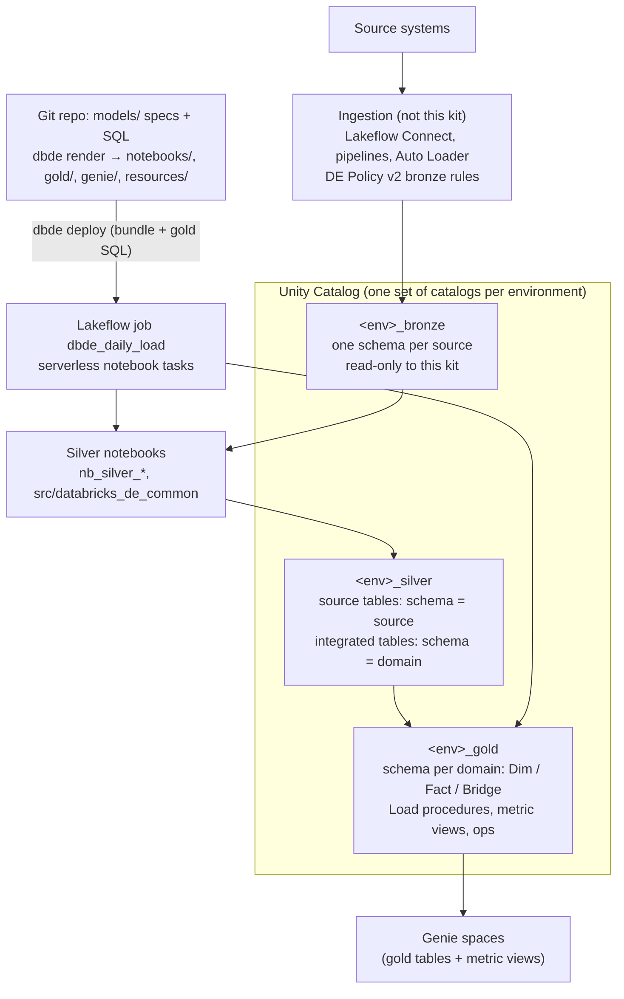

# Databricks Data Engineering Standards (no dbt)

Nov 6, 2026 · Sanmari Vivier · **Status: Draft.** Items marked **[Spike]** must be confirmed in a Sprint 0 technical spike before the rule is final (section 15).

## 0. How to read this document

This is the standard behind the Databricks data engineering agent kit (no dbt). It is the Databricks counterpart of `fabric_engineering_standards.md` in the Fabric kit, and the no-dbt alternative to `databricks_dbt_engineering_standards.md` in the dbt kit. The layers, the agent workflow and the quality bar are the same in all three. The engine is different: there is no dbt.

| Keyword | Meaning |
| --- | --- |
| MUST / MUST NOT | Mandatory. `python -m dbde check` or CI blocks the pull request when it is violated. |
| SHOULD / SHOULD NOT | Default. A departure needs a one-line reason in the pull request. |
| MAY | Optional. Use when it helps. |

## 1. Purpose and scope

All transformation from bronze to gold runs in Databricks on Unity Catalog:

- Silver runs as PySpark notebooks (Databricks notebook source format) with Delta MERGE, one notebook per table.
- Gold runs as Unity Catalog SQL stored procedures with SQL MERGE, one procedure per table.
- Gold facts with measures get a Unity Catalog **metric view**. **Genie spaces** are rendered from specs and read only gold.
- One Lakeflow job runs the daily load. Everything is deployed with a **Databricks Asset Bundle**.
- Ingestion into bronze is out of scope. It stays in Lakeflow Connect, Lakeflow pipelines or Auto Loader and follows Calybre DE Standards Policy v2 unchanged.

**Why not dbt.** dbt on Databricks has no notebooks and no stored procedures. DE Policy v2 requires both (notebooks in silver, one stored procedure per gold table), so the dbt kit needs TEC exceptions. This kit keeps what made dbt valuable and implements it with a small Python toolkit (`dbde`) and native Databricks objects:

- declared table specs
- lineage
- tests that block bad data
- one place for each definition
- generated boilerplate

**Relationship to Calybre standards.**

| Calybre standard | How this document uses it |
| --- | --- |
| DE Standards Policy v2 | Followed directly, with no exceptions: notebooks in silver, one stored procedure per gold table, `_BK` / `_SK`, audit columns, `StartDate` / `EndDate` / `IsCurrent`, MERGE, OPTIMIZE / VACUUM. Section 14 maps every rule. |
| Data Warehouse Naming Convention Template v1.0 | Governs naming where the policy is silent (PascalCase, `Is`/`Has`, no abbreviations). The policy wins where they conflict. |

**Out of scope:** bronze ingestion design, workspace and metastore setup, and dashboard design.

## 2. Reference architecture



One SQL warehouse per environment serves the toolkit (tests, `show`, gold deploys, profiling) and Genie. The job's notebook tasks run on serverless compute.

## 3. Workspaces, catalogs and identities

### 3.1 Catalogs and workspaces

| Environment | Catalogs (default names) | Who writes |
| --- | --- | --- |
| dev | `dev_bronze`, `dev_silver`, `dev_gold` | Developers (`python -m dbde build --target dev`) |
| test | `test_bronze`, `test_silver`, `test_gold` | Release pipeline service principal |
| prod | `prod_bronze`, `prod_silver`, `prod_gold` | Release pipeline / prod service principal |

- Catalog names come from `dbde.yml` (`targets.<env>.catalogs`, default `<env>_<layer>`). Rendered code never names a catalog. It uses the tokens `${bronze_catalog}`, `${silver_catalog}` and `${gold_catalog}`. Notebooks replace them from job parameters, and `dbde deploy` replaces them in the gold SQL. So the code never changes between environments.
- Schema layout: by default one schema per spec folder (`dev_silver.policy_admin.Policy`). A client that keeps all layers in one catalog sets `layer_schemas` in `dbde.yml` (`life_insurance.silver.Policy`, `life_insurance.gold.DimAgent`). Then table names must be unique per layer (rule N5), and the `ops` objects stay in `<gold catalog>.ops`.
- Schemas are created by the kit (`CREATE SCHEMA IF NOT EXISTS`). Catalogs are created by a platform admin. **[Decision for the client]**: one workspace per environment, or one workspace with per-environment catalogs bound to it.
- Business consumers MUST NOT have `USE CATALOG` on silver or bronze. They get `SELECT` on the gold objects of a Genie space (rendered `gold/ops/grants/<Space>.sql`) and `CAN_RUN` on the space.
- Dev and test bronze SHOULD read prod bronze (Delta Sharing, or a view catalog over prod bronze), never copies. Before personal data is exposed to developers, the client MUST approve it. **[Decision for the client]**
- **Notebooks are not edited in the workspace.** They are rendered from the repo and deployed by the bundle. Edits made in the workspace are overwritten by the next deploy.

### 3.2 Identities

| Principal | dev | test | prod |
| --- | --- | --- | --- |
| Developers (group) | `ALL PRIVILEGES` on `dev_*` | `SELECT` (debug only) | none, or `SELECT` on gold |
| Release service principal | none | owner of `test_*`, job `run_as` | none |
| Prod service principal | none | none | owner of `prod_*`, job `run_as` |
| Matrix service principal | `SELECT` | `SELECT` | `SELECT` on silver and gold only |

- Scheduled runs MUST run as a service principal, never as a person. Test and prod bundle targets are `mode: production` with `run_as: service_principal_name: ${var.run_as_service_principal}`, set by the release pipeline.
- Secrets MUST NOT be committed. The toolkit uses Databricks unified authentication (`databricks-sdk`). In CI it reads `DATABRICKS_HOST`, `DATABRICKS_CLIENT_ID` and `DATABRICKS_CLIENT_SECRET` (OAuth machine-to-machine). On a laptop it uses the target's CLI profile from `dbde.yml`, created once with `databricks auth login --host <url> --profile <name>`.
- `dbde.yml` names each target's CLI profile, SQL warehouse (by name) and catalogs. It never holds hosts, ids or tokens. The bundle looks the warehouse id up by name. Targets marked `protected: true` (test, prod) refuse writes unless `DBDE_ALLOW_PROTECTED=1`, which only the release pipeline sets.

## 4. How this kit replaces dbt

| dbt feature | This kit |
| --- | --- |
| `models/*.sql` + `schema.yml` | `models/<layer>/<schema>/<Table>.yml` (the spec) + `<Table>.sql` (the SELECT, where needed) |
| `ref()` / `source()` | `{{ ref('schema.Table') }}` in the SELECT, resolved to `${<layer>_catalog}.schema.Table` by `dbde render`; silver source tables name their bronze table in the spec |
| Materialisations | Rendered code: silver notebooks (Delta MERGE), gold `Load<Table>` stored procedure (SQL MERGE, SCD2) |
| `dbt parse` | `python -m dbde parse` (writes a dbt-shaped `target/manifest.json`) |
| `check_layers.py`, `dbt_project_evaluator` | `python -m dbde check` (section 12) |
| `dbt build` | `python -m dbde build --target dev` (deploy, run silver, test, load gold, test) |
| `dbt test`, generic tests | `python -m dbde test` in dev; `ops.RunDataQualityTests` in the job (section 8) |
| `dbt show --inline` | `python -m dbde show "select ..."` (read-only, refs allowed) |
| `codegen.generate_source` | `python -m dbde generate-source <source>` |
| Contracts | Every column is declared with a type; the load casts to it; the table DDL is rendered from it |
| Snapshots | `scd_type: 2` on a gold dimension |
| Semantic layer / metric views | `measures:` on a fact → `Metric<Process>` metric view |
| `docs` / manifest | The specs; Unity Catalog comments (from the descriptions); `target/manifest.json`; the Information Matrix |

**Rendered code is owned by the toolkit.** `databricks.yml`, `resources/*.yml`, `notebooks/**`, `gold/**` and `genie/*.json` are generated by `python -m dbde render` and committed, so reviewers see exactly what will run. They MUST NOT be edited by hand. `python -m dbde check` fails when a rendered file differs from what the specs produce (rule R1).

## 5. Bronze and sources

- Bronze MUST be loaded following DE Policy v2 section 3: a previous-day date parameter, the policy's partition layout, native file retention, and pipelines preferred over code.
- Bronze tables this kit reads MUST be Delta tables in the bronze catalog (one schema per source) and SHOULD carry `_ingested_at` (UTC). Files-only bronze (a volume of CSV/JSON) is first landed into a bronze table by the ingestion pipeline.
- Every bronze table the kit reads MUST be declared in `models/sources/<source>.yml`. Generate it with `python -m dbde generate-source <source>` (it reads `information_schema.columns`), then add the descriptions and the freshness rule:

```yaml
source: policy_admin
description: Policy administration system tables, landed daily into the bronze catalog by Lakeflow pipelines.
freshness:
  loaded_at_column: _ingested_at
  warn_after_hours: 26
  error_after_hours: 48
tables:
  - name: policy
    description: One row per policy version as held in the admin system.
    columns:
      - {name: policy_no, data_type: string}
```

Column types in a source spec are as Unity Catalog reports them. They are documentation, not casts. When the bronze schema name differs from the source name, set `schema:`.

## 6. Silver (PySpark notebooks, Delta)

Silver is the conformed layer: typed, keyed on business keys, deduplicated and merged. There are two kinds of silver table. The kind follows from the spec.

| Kind | Purpose | Spec | Schema (folder) | Reads |
| --- | --- | --- | --- | --- |
| **Source table** | The single clean entry point for exactly one bronze table (1:1) | `.yml` with `source:` and an `expression` per column; no `.sql` | the source name, e.g. `policy_admin` | one bronze table |
| **Integrated table** | Joins, business rules, re-graining (the dbt "intermediate" layer) | `.yml` + `.sql` (Spark SQL SELECT) | a business domain, e.g. `sales` | silver tables via `ref()` |

### 6.1 Source tables

Allowed in the column `expression` (Spark SQL over the bronze columns):

- renaming
- casting
- simple maths
- `case` buckets and `Is`/`Has` flags
- trimming and upper-casing codes
- null handling with an explicit `'UNKNOWN'`
- conversion to UTC

Forbidden: joins, aggregations and business rules. Those go in integrated tables.

```yaml
# models/silver/policy_admin/Policy.yml
description: >
  One row per policy as currently held in the policy admin system.
  Grain = Policy_BK.
source: {source: policy_admin, table: policy}
load: {mode: incremental, column: _ingested_at, lookback_days: 3}
dedupe_order_by: ["_ingested_at desc"]
columns:
  - name: Policy_BK
    data_type: string
    expression: upper(trim(policy_no))
    business_key: true
    description: Policy number from the policy admin system.
  - name: PolicyStatusCode
    data_type: string
    expression: coalesce(upper(trim(policy_status)), 'UNKNOWN')
    description: Policy status code (IF in force, LA lapsed, UNKNOWN missing).
    tests:
      - accepted_values: {values: [IF, LA, UNKNOWN]}
```

- `load.mode: incremental` reads bronze rows whose `load.column` is on or after `load_date` minus `lookback_days`. `full` reads the whole table. Every run MERGEs, so a rerun is safe. The job parameter `full_refresh=true` reads all of bronze once.
- `dedupe_order_by` keeps the first row per business key by that ordering, for example the latest ingested row. Without it, a repeated key fails the run.
- The notebook fails when a bronze column it uses is missing. Source changes never load silently.

### 6.2 Integrated tables

```sql
-- models/silver/sales/NewBusinessPolicy.sql  (Spark SQL)
select
    policy.Policy_BK,
    policy.Agent_BK,
    policy.AnnualPremiumAmount,
    policy.IssueDate
from {{ ref('policy_admin.Policy') }} as policy
where policy.IssueDate is not null
```

- Read only silver tables, only through `ref()`. Never bronze, never gold (rules L3, L5).
- The SELECT MUST return exactly the spec's columns. The notebook casts them to the declared types and fails if the business key repeats.
- `:load_date` MAY be used as a named parameter for date windows.
- Keep each table to about 4 to 6 inputs. Isolate each business rule in its own table so it can be tested.

### 6.3 Column structure, types and notebooks

- Column order (DE Policy v2, 4.2) is business keys, then data, then `InsertLoadStepID`, `InsertTimestamp`, `LastUpdateLoadStepID`, `LastUpdateTimestamp`. The audit columns are added by the shared library. Specs MUST NOT declare them.
- The business key is declared as the table's Unity Catalog `PRIMARY KEY` constraint (`<Table>_pk`, informational) and enforced by the implied tests (DE Policy v2: a logical primary key on every table).
- Spark types: `string`, `varchar(n)`, `boolean`, `tinyint`, `smallint`, `int`, `bigint`, `decimal(p,s)`, `date`, `timestamp`, `timestamp_ntz`, `binary`, `float`, `double`. Money is `decimal(18,2)`. Floating types for money are forbidden (rule D3).
- Every silver table gets one rendered notebook, `notebooks/silver/nb_silver_<schema>_<table>.py`, in Databricks notebook source format. It has these cells:
  1. Markdown first: purpose, source, target, read mode, load, parameters.
  2. Widgets: `load_date`, `load_step_id`, `full_refresh` and the three catalogs (job parameters arrive as widgets).
  3. The import of the shared library.
  4. A settings cell rendered from the spec.
  5. A documented `main()` (Google docstring, type hints).
  6. A short driver cell.
- Shared logic (read, conform, dedupe, `CREATE TABLE`, add new columns, sync comments, MERGE with audit columns) lives once, in `src/databricks_de_common/silver.py`. It is synced with the bundle, and notebooks add `<bundle root>/src` to `sys.path`. They never use `%run` (DE Policy v2, 4.3.4).
- New spec columns are added to the Delta table with `ALTER TABLE ADD COLUMNS`, never by schema inference or `mergeSchema`. Renaming or retyping a column needs a migration notebook, run once and recorded in the pull request.
- Unity Catalog table and column comments follow the spec descriptions on every run. Genie and Catalog Explorer read them.

## 7. Gold (Unity Catalog, SQL stored procedures)

### 7.1 Tables and naming

- Gold tables are `Dim<Entity>` (singular), `Fact<BusinessProcess>` or `Bridge<A><B>`, in one schema per business domain (`models/gold/<domain>/`). Shared dimensions go in a `shared` domain. The schema `ops` is reserved for the kit.
- One concept, one gold table. A name MUST NOT repeat across domains (rule G5).
- Each gold table has a spec (`.yml`) and a Databricks SQL SELECT (`.sql`) that reads silver and other gold tables through `ref()`.

### 7.2 What gets rendered

| File | What it is |
| --- | --- |
| `gold/<domain>/tables/<Table>.sql` | Idempotent DDL. Creates the schema and the table when missing (columns in policy order, comments from the spec, `CONSTRAINT <Table>_pk PRIMARY KEY (<Table>_SK)` and a `FOREIGN KEY` per `references` column). Adds new nullable columns and missing foreign keys (SQL scripting `IF NOT EXISTS`), keeps the comments in step with the spec and inserts the unknown member row of a dimension. |
| `gold/<domain>/procedures/Load<Table>.sql` | `CREATE OR REPLACE PROCEDURE <domain>.Load<Table>(RunLoadDate DATE, RunLoadStepID STRING) LANGUAGE SQL SQL SECURITY INVOKER`: the one stored procedure per destination table. The SELECT is the first CTE (`source_rows`) of its MERGE, followed by a `typed` CTE with explicit casts to the spec types. The logic lives in the procedure. |
| `gold/<domain>/metric_views/Metric<Process>.sql` | A metric view per fact with measures (section 7.6). |
| `gold/ops/...` | `ops.DataQualityResult`, `ops.RunDataQualityTests`, `ops.RunGoldLoads`, Genie grants. |

Rendered SQL files separate top-level statements with a `-- GO` line. `dbde deploy` replaces the catalog tokens, splits on those lines and runs the statements in dependency order through the SQL warehouse.

### 7.3 Column structure

DE Policy v2, 5.2. The kit adds the bracketed columns. Specs declare only business keys and data.

`[<Table>_SK]` · business keys `_BK` · data · `[StartDate]` · `[EndDate]` · `[IsCurrent]` (type 2 only) · `[InsertLoadStepID]` · `[InsertTimestamp]` · `[LastUpdateLoadStepID]` · `[LastUpdateTimestamp]`

- `<Table>_SK` is `bigint`, assigned by the load procedure as the current maximum plus `row_number()`. It does not use an identity column, because the unknown member row needs a fixed value, `-1`, and MERGE inserts into identity columns are restricted.
- The logical primary key is the business key, independent of the surrogate key (DE Policy v2, 5.1.2). It is enforced by the implied tests. The `_SK` is the informational `PRIMARY KEY` in Unity Catalog, and `references` columns are informational `FOREIGN KEY`s. Genie and BI tools use them to join.
- A fact or bridge stores dimension keys as `[<Role>]<DimTable>_SK bigint` with `references: <domain>.<DimTable>` in the spec. Examples are `DimAgent_SK` and `IssueDimDate_SK`. The SELECT resolves them with a point-in-time join and `coalesce(..., -1)`:

```sql
-- models/gold/sales/FactNewBusiness.sql  (Databricks SQL)
select
    new_business.Policy_BK,
    coalesce(agent.DimAgent_SK, -1) as DimAgent_SK,
    new_business.AnnualPremiumAmount,
    new_business.IssueDate
from {{ ref('sales.NewBusinessPolicy') }} as new_business
left join {{ ref('distribution.DimAgent') }} as agent
    on agent.Agent_BK = new_business.Agent_BK
    and new_business.IssueDate between agent.StartDate and agent.EndDate
```

### 7.4 Load behaviour

| Table | Spec | Load procedure |
| --- | --- | --- |
| Type 2 dimension | `scd_type: 2` | One MERGE closes the current version of changed rows (`EndDate = RunLoadDate - 1`, `IsCurrent = false`) and inserts the new version (`StartDate = RunLoadDate`, `EndDate = 9999-12-31`). Changed rows are staged twice (`MergeKey1..n`, once with a `NULL` key). A key seen for the first time starts at `1900-01-01`. Every row has `StartDate` / `EndDate` / `IsCurrent`. |
| Type 1 dimension | `scd_type: 1` | MERGE updates changed rows in place and inserts new keys. |
| Fact / bridge | (none) | MERGE on the business key. `load: {mode: incremental, column: <date>, lookback_days: n}` limits the source to rows on or after `RunLoadDate - n`. |

- Unchanged rows are never touched. The change test is null-safe on every data column (`NOT (a <=> b)`).
- Rows that disappear from the source are not deleted. Soft-delete handling is a business rule: add an `Is<Deleted>` column. **[Decision per table]**
- The SELECT MUST NOT use `:parameters`, `${...}`, the procedure's own names (`RunLoadDate`, `RunLoadStepID`, `RunTimestamp`, `MaxKey`, `NewKey`, `MergeKey<n>`), `limit` or non-deterministic functions (`current_date()`, `current_timestamp()`, `rand()`, `uuid()`). `order by` is ignored (warn). Dates enter through `RunLoadDate` (rules G6, G7, I1).
- Period-end results the business signs off (month-end in-force, valuation extracts) MUST be stored as append-only period facts keyed by an as-at date. Delta time travel is limited by VACUUM retention, so it is not an audit mechanism.

### 7.5 Types and schema changes

| Kind | Type |
| --- | --- |
| Keys and codes | `string`, or `varchar(n)` where the length is a rule |
| Free text | `string` |
| Money | `decimal(18,2)` |
| Rates, factors | `decimal(18,8)` |
| Flags | `boolean` |
| Dates | `date` |
| Timestamps | `timestamp` (UTC) |
| Counts | `int` / `bigint` |

- T-SQL types are rejected by rule D2 with the Databricks type to use: `nvarchar`, `nchar`, `text`, `datetime`, `datetime2`, `smalldatetime`, `datetimeoffset`, `money`, `bit`, `uniqueidentifier` and similar.
- String comparison is case-sensitive by default, so codes MUST be upper-cased and trimmed in silver.
- Adding a column: add it to the spec. The rendered DDL adds it as nullable. Changing a type or removing a column: write a one-off migration script, run it in each environment through the release pipeline, and record it in the pull request.

### 7.6 AI enablement: metric views and Genie spaces

Gold is the only layer AI reads. The kit renders two kinds of object from the specs, so Genie sees exactly what the standards describe and nothing else.

| Object | Source | Rendered to |
| --- | --- | --- |
| Unity Catalog metric view `Metric<Process>` (one per fact with measures; `FactNewBusiness` → `MetricNewBusiness`) | the fact's `measures:`, its columns and the columns of the dimensions it `references:` | `gold/<domain>/metric_views/Metric<Process>.sql` (`CREATE OR REPLACE VIEW ... WITH METRICS LANGUAGE YAML`, version 1.1) |
| Genie space | `models/genie/<Name>.yml` | `genie/<Name>.geniespace.json` (serialized space), `resources/genie_<name>.yml` (bundle resource), `gold/ops/grants/<Name>.sql` |

- **Measures.** A measure `expression` MUST be an aggregate (`sum`, `count`, `avg`, `min`, `max`, `count(distinct ...)`, `percentile`, ...) over the fact's columns (rule A1). Its description becomes the measure comment Genie reads. Its name MUST NOT repeat a dimension name.
- **Dimensions of a metric view.** The fact's own non-key, non-numeric columns and those of each referenced dimension (joined on `_SK`, named after the dimension). A name that repeats gets the dimension's name as prefix. Numeric columns become measures, not dimensions.
- **Descriptions and synonyms.** The spec description is the AI's knowledge of a column. `synonyms:` (table, column, measure) go into the metric view and the table description. `ai_instructions:` on a table go into the space instructions as "Table guidance". Synonyms and guidance are facts people give; nobody guesses them.
- **Personal data.** `genie.pii: exclude` (default, in `dbde.yml`) leaves columns marked `meta.pii: true` out of every metric view. Genie cannot hide single columns of a table, so a space MUST NOT list a table with PII columns (rule A5). The metric view is the safe source for those tables. PII column names MUST NOT appear in instructions, questions or examples (rule A8).
- **Genie space.** The spec states a title, a description (who it is for, what it answers), instructions (what it must never do, units, date conventions), its tables (gold tables and metric views), sample questions, three or more example question/SQL pairs over `{{ ref() }}`, optional benchmarks, and the consumer groups (`permissions.can_run`). Examples are checked offline (read-only, valid Databricks SQL, only the space's tables) and run with `python -m dbde test-genie`, which makes them regression tests for the SQL Genie is shown. Judging Genie's own answers is a manual step (benchmarks in the Genie UI).
- **Publishing.** The space is a bundle resource (`genie_spaces`). `dbde deploy` writes the target's copy of the serialized space (catalogs resolved) to `target/genie/` and deploys the bundle. The space runs on the target's SQL warehouse. Consumers get `CAN_RUN` on the space and `SELECT` on its objects through the rendered grants. **[Spike]**
- **Unstructured data (pattern, not rendered).** AI functions over text (`ai_query`, `ai_classify`, `ai_extract`) are not rendered by this kit yet. A project that needs them MUST: keep the source key on every derived row (provenance); version prompts in the repo and record the prompt version and model endpoint in the table `meta`; run the function only in an incremental silver load so each row is scored once; declare the output schema with `accepted_values` on labels; and test that generated text is grounded in its source. Adding it needs a toolkit change (a new silver table kind in `dbde/render.py`), not a hand-written notebook.

## 8. Data quality tests

Every test is a query that returns failing rows. The same generated SQL runs in development (`python -m dbde test`) and in production (`ops.RunDataQualityTests`, called by the job).

### 8.1 Implied tests (every table, no spec needed)

| Table | Tests |
| --- | --- |
| Bronze table with freshness | `freshness_warn` / `freshness_error` on `loaded_at_column` |
| Silver | `not_null` on each business key; `unique` (or `unique_combination`) on the business key |
| Gold | the silver tests, plus `not_null` + `unique` on `_SK`; `not_null` + `relationships` on every `references` column |
| Type 2 dimension | `one_current_row` per business key, `no_overlapping_versions`, `StartDate <= EndDate` |

### 8.2 Declared tests

Column tests (under a column's `tests:`):

- `not_null`
- `unique`
- `accepted_values: {values: [...]}`
- `relationships: {to: schema.Table, field: Column}`
- `accepted_range: {min:, max:}`
- `expression: "<predicate>"`

Table tests (under the model's `tests:`):

- `expression: "<predicate that must hold on every row>"`
- `unique_combination: {columns: [...]}`
- `row_count_between: {min:, max:}`
- `recency: {column:, max_age_hours:}`
- `reconciles_to: {column:, compare_to: schema.Table, compare_column:, group_by: [...], tolerance:}`

Every test MAY set `severity: warn`. The default is `error`.

### 8.3 What to test

| Risk | Test |
| --- | --- |
| Duplicate keys | implied `unique` / `unique_combination` |
| Unknown codes | `accepted_values`; replace null codes with `'UNKNOWN'` in silver |
| Missing dimension rows | implied `relationships` on `_SK` columns; watch `-1` counts |
| Impossible values | `accepted_range`, `expression` (e.g. `IssueDate >= ApplicationDate`) |
| Join fan-out | `unique` on the integrated table's grain |
| Silent volume drops | `row_count_between`, `recency` |
| Totals that must match a system of record | `reconciles_to` a control-total table |

Financial and actuarial facts MUST reconcile to at least one independent control total before release, with the tolerance agreed with the data owner (zero for counts). Control totals are landed in bronze like any other source.

### 8.4 Severity and failure handling

- `error` tests stop the job. `ops.RunDataQualityTests` logs every count to `ops.DataQualityResult` and then raises an error (`SIGNAL SQLSTATE '45000'`), so the next layer does not load and yesterday's gold stays in place. For finance, stale but right beats fresh but wrong.
- `warn` tests are logged only. Every `warn` MUST link to a work item. A `warn` older than two sprints is either fixed or promoted to `error`.
- `ops.DataQualityResult` (`LoadStepID`, `Layer`, `TableName`, `TestName`, `Severity`, `FailureCount`, `TestedTimestamp`) in the gold catalog is the data trust record. Dashboards SHOULD show the last successful load.

## 9. Orchestration and deployment

### 9.1 The daily job

`resources/dbde_daily_load.job.yml` is rendered from the specs. Every task is a notebook task on serverless compute:

| Task | Notebook | Depends on |
| --- | --- | --- |
| `test_source` | `nb_ops_run_tests` (`layer=source`) | none |
| `silver_<schema>_<table>` | `nb_silver_<schema>_<table>` | `test_source` and the silver tables it reads |
| `test_silver` | `nb_ops_run_tests` (`layer=silver`) | every silver task |
| `gold_<domain>_<table>` | `nb_ops_load_gold` (`procedure=<domain>.Load<Table>`) | `test_silver` and the gold tables it reads (dimensions first) |
| `test_gold` | `nb_ops_run_tests` (`layer=gold`) | every gold task |

Job parameters reach every task as widgets:

- `load_date`, empty by default, which means yesterday (UTC) (DE Policy v2: previous-day date).
- `load_step_id` is `{{job.run_id}}`. That is the provisional answer to DE Policy v2 open question 2 (logging). It makes every row traceable to a job run.
- `full_refresh`, the three catalogs (`${var.<layer>_catalog}`) and `bundle_root` (`${workspace.file_path}`).

The schedule and failure e-mails come from `dbde.yml` (`daily_load`). Development mode pauses schedules in dev. On failure, the job MUST notify the delivery team. A rerun for a past date passes `load_date` explicitly and is noted in the run log.

`resources/dbde_table_maintenance.job.yml` runs `nb_ops_maintain_tables` weekly: `OPTIMIZE` then `VACUUM ... RETAIN <n> HOURS` (at least 168) on every silver and gold table (DE Policy v2, 4.1.5). Predictive optimization MAY replace it where the account enables it. **[Decision]**

### 9.2 Deployment

`python -m dbde deploy --target <env>`:

1. Refuses to run if the rendered files are out of date.
2. Runs the gold SQL through the target's SQL warehouse, in order: the ops table, tables (dimensions first), load procedures, metric views, ops procedures, grants. Every script is idempotent.
3. Writes the target's Genie serialized spaces to `target/genie/` and runs `databricks bundle deploy --target <env>`: notebooks, `src/` (the shared library), jobs and Genie spaces.

`--sql-only` and `--bundle-only` run one half. On a fresh workspace, run `python -m dbde build` once instead: it deploys in the order that works before any table exists (bundle, silver, gold SQL, gold).

### 9.3 Development loop

```bash
python -m dbde check                       # rules + render drift (offline)
python -m dbde render                      # regenerate notebooks, SQL, bundle
python -m dbde build --target dev          # deploy, run silver, test, load gold, test
python -m dbde build --target dev --layer gold --skip-deploy   # gold only
python -m dbde test --target dev --select DimAgent
python -m dbde show "select count(*) as n from {{ ref('sales.FactNewBusiness') }}"
python -m dbde test-genie --target dev
```

### 9.4 CI and release

- Pull requests: `.github/workflows/dbde_ci.yml` runs `dbde parse`, `dbde check` (including render drift) and the toolkit tests. It needs no secrets. With Azure Repos, attach the same steps as a build validation branch policy. `databricks bundle validate` MAY be added where CI has workspace credentials.
- Release, a separate pipeline per environment and an open policy question (DE Policy v2, Q4): as the release service principal with `DBDE_ALLOW_PROTECTED=1` and `BUNDLE_VAR_run_as_service_principal=<application id>`, run `python -m dbde build --target test`, then repeat for prod after approval.
- Branch policy MUST require one reviewer. Changes under `models/**/finance/**` or `models/**/actuarial/**` SHOULD also require a business reviewer.

## 10. Naming and style

| Thing | Rule | Example |
| --- | --- | --- |
| Catalogs | `<env>_<layer>` (lower snake_case) | `prod_gold` |
| Schemas (folders) | lower snake_case; source name (silver source), domain (integrated, gold) | `policy_admin`, `sales` |
| Silver tables | PascalCase, singular, no Dim/Fact/Metric prefix | `Policy`, `NewBusinessPolicy` |
| Gold tables | `Dim` / `Fact` / `Bridge` + PascalCase | `DimAgent`, `FactNewBusiness` |
| Metric views | `Metric` + the fact's process | `MetricNewBusiness` |
| Business key | `<Entity>_BK`, marked `business_key: true` | `Policy_BK` |
| Foreign business key (silver) | the other table's key name | `Agent_BK` on `Policy` |
| Surrogate key | `<Table>_SK` (added by the kit); foreign: `[<Role>]<DimTable>_SK` | `DimAgent_SK` |
| Boolean | `Is` / `Has` + PascalCase, `boolean` | `IsActive` |
| Date / timestamp | `...Date` is `date`; `...Timestamp` is `timestamp`, UTC | `IssueDate` |
| Money | `...Amount`, `decimal(18,2)` | `AnnualPremiumAmount` |
| Codes | `...Code`, upper-cased in silver | `PolicyStatusCode` |
| Notebooks | `nb_silver_<schema>_<table>`, `nb_ops_<purpose>` | `nb_silver_policy_admin_policy` |
| Procedures | `<domain>.Load<Table>`, `ops.<Verb><Noun>` | `distribution.LoadDimAgent` |
| Genie spaces | PascalCase spec name; resource `genie_<snake>` | `SalesAnalyst` |
| Constraints | `<Table>_pk`, `<Table>_<Column>_fk` | `DimAgent_pk` |

- No abbreviations (`Amount`, not `Amt`; rule N8 lists the common ones).
- SELECT style in `.sql` files:
  - lowercase keywords and 4-space indents
  - import CTEs first, then `select` from the final CTE
  - explicit `as`
  - `inner join` / `left join` only
  - no initialism aliases
  - columns prefixed with the CTE name when joining
- Gold SELECTs list their grouping columns. `group by all` is allowed in Genie examples, not in loads.
- YAML: 2-space indents. Descriptions state the grain on the table (`Grain = ...`) and give the meaning, unit and allowed values on every column.

## 11. Information Matrix

The Information Matrix workbook is generated from the specs by `scripts/build_information_matrix.py`. `python -m dbde parse --target <env>` writes a dbt-shaped `target/manifest.json` with that target's catalog names, so the script is the dbt kit's script with only the connection changed.

- Facts only people know go in `meta.matrix` on the model or column (see `.github/instructions/gold.instructions.md`). Mark PII with `meta.pii: true`. Never guess these values.
- Measures are declared on facts (`measures:` with `name`, `expression`, `description`). They become the metric view and fill the Measures sheet.
- The BUS Matrix comes from `references` columns (implied `relationships` tests).
- Column lineage (Source Table / Source Columns) comes from the specs: silver expressions, explicit `lineage:` entries, or same-named columns in the tables a model reads. Unity Catalog lineage MAY be used to confirm it.
- The workbook holds sampled values. It is written to `target/` and MUST NOT be committed.

## 12. Check rules (`python -m dbde check`)

| Rule | Checks |
| --- | --- |
| P0 | Spec files load (valid YAML, no duplicate tables, no orphan `.sql`) |
| P2 | Each target has lower snake_case catalogs and a SQL warehouse name |
| R1 | Rendered files match the specs (no hand edits, nothing stale) |
| L1–L8 | Layer rules: silver source tables read a declared bronze table (L1) and have no `.sql` (L2); silver never reads gold, gold never reads metric views (L3); dimensions reading facts (L4, warn); no hard-coded catalog names or `source()` in SELECTs (L5); one silver table per bronze table (L6); bronze tables without silver (L7, warn); refs exist, no self-reads (L8) |
| S1–S10 | Spec completeness: descriptions (S1), grain stated (S2), columns (S3), business key (S4), expressions (S5), incremental column (S6), freshness (S7), source columns (S8), `.sql` present (S9), kit-owned and procedure-reserved names not declared (S10) |
| D1–D3 | Types: allowed Databricks types (D1), no T-SQL types (D2), no floating money (D3) |
| N1–N10 | Naming: PascalCase tables (N1), prefixes (N2), columns (N3), schemas (N4), schema reuse and the reserved `ops` schema (N5), `_BK` (N6), `_SK` gold only (N7), abbreviations (N8, warn), `Is`/`Has` (N9), `Date`/`Timestamp` types (N10) |
| G1–G7 | Gold: SCD type set (G1), `references` valid (G2, G3), measures on facts (G4), unique names (G5), no `:parameters`, `${...}` or procedure names in the SELECT (G6), no `limit` (G7), `order by` (G7, warn) |
| T1–T3 | Tests: known types and severities (T1), arguments (T2), targets exist (T3) |
| I1 | No non-deterministic functions in SELECTs |
| P1 | Columns that look like personal data have `meta.pii` set (warn) |
| A1–A9 | AI: measures aggregate and do not reuse a dimension name (A1); synonyms are lists, `ai_instructions` is text (A2); a space has title, description, instructions and tables (A3); space tables are gold tables or metric views, examples are read-only valid Databricks SQL over the space's tables (A4); no PII table in a space, no measure over PII (A5); at least three examples (A6); at least one measure in gold (A7, warn); no PII column names in instructions, questions or examples (A8); a real consumer group (A9, warn) |

## 13. Data protection

- Columns holding personal data MUST carry `meta.pii: true` in every layer they appear in. Health, claims and person-level financial amounts are sensitive; list them for a decision.
- The matrix profiler never samples PII columns. Agents never print PII values (`AGENTS.md`).
- PII columns never reach Genie: they are left out of metric views, and no Genie space may list a table that holds them (section 7.6, rules A5, A8).
- Gold objects exposed to broad groups SHOULD use Unity Catalog column masks or row filters on PII columns. **[Decision for the client]**

## 14. Alignment with Calybre DE Standards Policy v2

| Policy v2 rule | Implementation | Status |
| --- | --- | --- |
| Bronze: previous-day parameter, partitions, native files, pipelines over code | Unchanged (ingestion is not this kit) | Met |
| Silver: Delta, logical primary key, explicit types, Delta MERGE | Delta tables in the silver catalog; `business_key` as UC `PRIMARY KEY` + tests; declared types with explicit casts; `merge_into` | Met |
| Silver: VACUUM and OPTIMIZE before production | Rendered weekly maintenance job (`nb_ops_maintain_tables`) | Met |
| Silver: column order `_BK`, data, four audit columns | Rendered `CREATE TABLE`; audit columns set by the shared library | Met |
| Silver: notebooks, one per destination table, minimal context, shared UDFs, PEP 8, docstrings, markdown | Rendered notebooks; `databricks_de_common` library; docstrings and markdown cells generated; lines within 79 characters | Met |
| Gold: logical primary key independent of the surrogate | Business key tests; `_SK` assigned by the procedure | Met |
| Gold: column order `_SK`, `_BK`, data, `StartDate`/`EndDate`/`IsCurrent`, audit | Rendered DDL | Met |
| Gold: type 2 rows populated on every row, including the current version | SCD2 MERGE; `one_current_row` and `no_overlapping_versions` tests | Met |
| Gold: SQL MERGE, stored procedures, one per destination table | `Load<Table>` Unity Catalog SQL procedure per table, with the logic SELECT inside it | Met **[Spike]** |
| PRs: one per notebook / procedure / story | One spec (and its rendered files) per pull request; one story per pull request | Met |

The dbt kit needs TEC exceptions (no notebooks, no stored procedures). This kit needs none.

## 15. Sprint 0 spike: confirm before committing

Run once against a dev workspace (Unity Catalog, serverless enabled) and record the results:

1. **SQL stored procedures.** `CREATE OR REPLACE PROCEDURE ... LANGUAGE SQL SQL SECURITY INVOKER COMMENT ... AS BEGIN ... END` is available on the workspace's SQL warehouse and serverless compute (Databricks SQL / DBR versions, preview status). `CALL` with `CAST(:load_date AS DATE)` from a notebook. Whether `CREATE PROCEDURE` validates the tables its body reads at creation time (the reason `dbde build` deploys gold SQL after the silver run).
2. **SQL scripting.** `DECLARE ... DEFAULT`, `SET var = (scalar subquery)`, `IF NOT EXISTS (...) THEN ... END IF` and `SIGNAL SQLSTATE '45000' SET MESSAGE_TEXT = <variable>` inside procedures, and top-level `BEGIN ... END` blocks sent through `databricks-sql-connector`.
3. **MERGE.** The nested `WITH` inside the `source_rows` CTE, procedure variables inside the MERGE source and actions, and the SCD2 double-staging pattern. Fallback if a construct is unavailable: a change in `dbde/render.py` only.
4. **Informational constraints.** `PRIMARY KEY` and `FOREIGN KEY` in `CREATE TABLE` and `ALTER TABLE ADD CONSTRAINT` on the gold catalog; `information_schema.columns` and `.table_constraints` store names in lower case.
5. **Metric views.** YAML version 1.1 keys used by the kit (`comment`, `synonyms` on dimensions and measures, `joins` with `on`), and `measure()` with `group by all` from the SQL warehouse and from Genie.
6. **Genie bundle resource.** The `genie_spaces` resource keys (`title`, `description`, `warehouse_id`, `file_path`, `permissions` with `CAN_RUN`) in the pinned Databricks CLI version, and the serialized space fields (`version: 2`, `data_sources.tables` / `metric_views`, `instructions.text_instructions`, `example_question_sqls`, `benchmarks`). Confirm sorted ids are required.
7. **Bundle variables.** `lookup: warehouse:` per target; `run_as` with a service principal set through `BUNDLE_VAR_run_as_service_principal`; `--params` and `--only` on `databricks bundle run`.
8. **Notebook tasks.** Job parameters reach notebooks as widgets; `${workspace.file_path}/src` imports work on serverless; the fallback path (`../../src`) works for interactive runs.
9. **Maintenance.** `OPTIMIZE` / `VACUUM` permissions for the job's service principal, or predictive optimization on the account.
10. **Cost.** DBUs consumed by a full daily run (system tables `system.billing.usage`).

## 16. Pull request checklist

- [ ] One story; one table's spec, SQL and rendered files (or a stated reason)
- [ ] `python -m dbde check` passes; rendered files committed
- [ ] Grain in every table description; every column described (meaning, unit, allowed values)
- [ ] Business key marked; tests for codes, ranges and business rules; reconciliation for financial facts
- [ ] PII columns marked in every layer; no PII table in a Genie space
- [ ] `python -m dbde build --target dev` passes for the changed layer; `test-genie` passes when a space changed
- [ ] Information Matrix facts (`meta.matrix`) added where known, never guessed

## Sources

- Calybre DE Standards Policy v2 (`v2_Data Engineering Standards Policy.docx`) and Data Warehouse Naming Convention Template v1.0
- `fabric_engineering_standards.md` (Fabric kit) and `databricks_dbt_engineering_standards.md` (dbt kit)
- Databricks documentation: Unity Catalog, SQL stored procedures and SQL scripting, MERGE INTO, informational constraints, metric views, Genie spaces and the `genie_spaces` bundle resource, Declarative Automation Bundles (Asset Bundles), Lakeflow Jobs, databricks-sdk unified authentication
