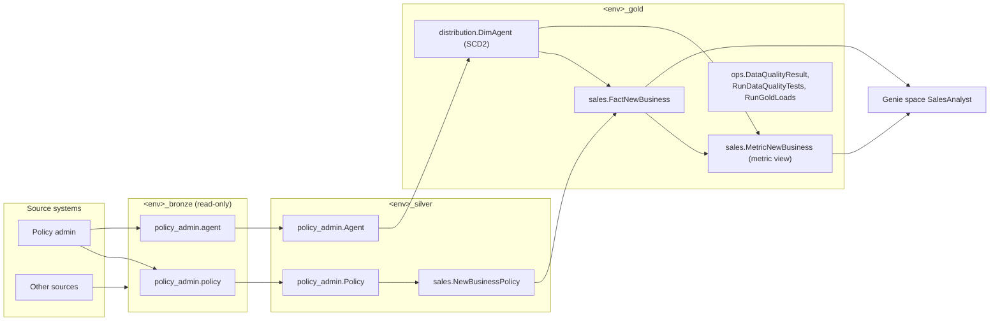
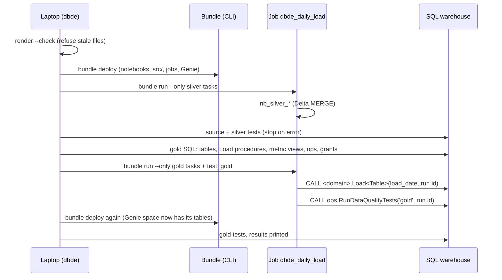

# How the kit works: `dbde.yml`, dbt parallels, architecture and data flow

This is a high-level explanation for people who know dbt. The kit does for Databricks what dbt does, without dbt. You write table **specs** and **SELECTs**, and the `dbde` toolkit generates the code, deploys it, runs it and tests it.

It generates native Databricks objects that DE Policy v2 asks for:

- PySpark notebooks (silver)
- Unity Catalog SQL stored procedures (gold)
- metric views and Genie spaces (AI)
- a Databricks Asset Bundle with the jobs

## 1. What `dbde.yml` is

`dbde.yml` is the project settings file. It plays the role of dbt's `dbt_project.yml` and `profiles.yml` together, and it holds no secrets.

| Section | What it does | dbt equivalent |
| --- | --- | --- |
| `project` | Project name (snake_case); the bundle and job names | `name:` in `dbt_project.yml` |
| `genie.pii` | `exclude`: PII columns never reach metric views or Genie | no equivalent |
| `daily_load` | Schedule (Quartz cron), time zone and failure e-mails of the daily job | an orchestrator's schedule |
| `maintenance` | Schedule and VACUUM retention of the weekly OPTIMIZE / VACUUM job | `post-hook`s, roughly |
| `defaults.freshness` | Default freshness rule written into new source specs | `freshness:` on sources |
| `targets` | `dev`, `test`, `prod`. Each names a Databricks **CLI profile** (local sign-in), a **SQL warehouse** (by name) and optionally its **catalogs** (default `<target>_bronze/silver/gold`). `test` and `prod` are `protected`: only the release pipeline writes to them | `outputs:` in `profiles.yml` |

Hosts and credentials live in the CLI profile (`databricks auth login`) or, in CI, in `DATABRICKS_HOST` / `DATABRICKS_CLIENT_ID` / `DATABRICKS_CLIENT_SECRET`. They are never in a file. `databricks.yml` (rendered) carries each target's catalogs into the jobs as bundle variables.

## 2. The dbt parallels at a glance

| Idea | dbt | This kit |
| --- | --- | --- |
| Table definition | `models/**/*.sql` + `schema.yml` | `models/**/<Table>.yml` spec (+ `.sql` for joins and rules) |
| Raw inputs | `sources:` + `{{ source() }}` | `models/sources/<source>.yml` + `{{ source() }}` (bronze) |
| Dependencies | `{{ ref('model') }}` | `{{ ref('schema.Table') }}`: catalog names are never hard-coded |
| Layers | staging, intermediate, marts | silver source tables, silver integrated tables, gold `Dim` / `Fact` / `Bridge` |
| Semantic layer | metrics / semantic models | `measures:` → Unity Catalog metric view; `models/genie/` → Genie space |
| Compile | `dbt compile` | `python -m dbde render` writes notebooks, SQL, metric views, Genie spaces and the bundle |
| Parse / lineage | `dbt parse`, `manifest.json` | `python -m dbde parse`, `target/manifest.json` |
| Lint | sqlfluff, project evaluator | `python -m dbde check`: all rules plus "rendered files are up to date" |
| Build | `dbt build` | `python -m dbde build --target dev`: deploy, run silver, test, load gold, test |
| Tests | generic and singular tests | the kit adds key, uniqueness, SCD2 and relationship tests; you add `accepted_values`, `accepted_range`, `expression`, `reconciles_to`, `recency` |
| Ad hoc query | `dbt show` | `python -m dbde show "select ..."` |
| Connection check | `dbt debug` | `python -m dbde debug --target dev` |
| Docs | `dbt docs` | descriptions become Unity Catalog comments (Catalog Explorer, Genie) and feed the Information Matrix |

Where it differs from dbt: the output is not a SELECT run by a warehouse. `render` produces **Delta MERGE notebooks** for silver and **one stored procedure per table** for gold. The rendered files are committed so reviewers see what runs, but nobody edits them (rule R1; `dbde check` fails on hand edits and stale files).

## 3. Data architecture

Each layer has its own catalog per environment. Bronze is loaded by ingestion pipelines, not by this repo. Silver and gold are built from specs; Genie reads only gold.



| Layer | Object | Built by | Key rules |
| --- | --- | --- | --- |
| Bronze | Delta tables, one schema per source | Ingestion (not this kit) | Read-only; `_ingested_at` for freshness |
| Silver source | One table per bronze table | `nb_silver_<source>_<table>` notebook | Rename, cast, trim, dedupe; no joins |
| Silver integrated | Joined / business-rule tables | `nb_silver_<domain>_<table>` notebook (Spark SQL SELECT) | Reads silver only |
| Gold | `Dim` / `Fact` / `Bridge` | `<domain>.Load<Table>` SQL procedure | `_SK`, SCD2, unknown member `-1`, PK/FK constraints |
| AI | `Metric<Process>` metric views, Genie spaces | Rendered from measures and `models/genie/` | No PII; examples tested |

## 4. What you write and what is generated

```
models/                                  (you and the agent)
  sources/policy_admin.yml
  silver/policy_admin/Policy.yml
  silver/sales/NewBusinessPolicy.yml + .sql
  gold/distribution/DimAgent.yml + .sql
  gold/sales/FactNewBusiness.yml + .sql
  genie/SalesAnalyst.yml
        │  python -m dbde render
        ▼
databricks.yml                           bundle: variables, targets dev/test/prod
resources/dbde_daily_load.job.yml        the daily job (task DAG from the specs)
resources/dbde_table_maintenance.job.yml weekly OPTIMIZE / VACUUM
resources/genie_sales_analyst.yml        Genie space resource
notebooks/silver/nb_silver_*.py          one notebook per silver table
notebooks/ops/nb_ops_*.py                load one gold table, run tests, maintain
gold/<domain>/tables/<Table>.sql         DDL, comments, PK/FK, unknown member
gold/<domain>/procedures/Load<Table>.sql the MERGE procedure
gold/<domain>/metric_views/Metric*.sql   metric views
gold/ops/...                             DQ table and procedures, RunGoldLoads, grants
genie/SalesAnalyst.geniespace.json       serialized Genie space (catalog tokens)
src/databricks_de_common/                shared library (part of the kit, not rendered)
```

Rendered SQL and the Genie JSON never name a catalog. They use `${bronze_catalog}`, `${silver_catalog}` and `${gold_catalog}`:

- notebooks replace the tokens from job parameters
- `dbde deploy` replaces them when it runs the gold SQL, and writes a resolved copy of each Genie space to `target/genie/` for the bundle

## 5. Data flow of a build and of the daily load

`python -m dbde build --target dev`:



The scheduled daily job runs the same tasks in one DAG:

1. `test_source`
2. every `silver_*` task (in dependency order)
3. `test_silver`
4. every `gold_*` task (dimensions first)
5. `test_gold`

A failing error-severity test raises an error in `ops.RunDataQualityTests`, so the next layer does not run and yesterday's data stays in place.

## 6. Where tests and environments fit

| Where | Command | Writes to |
| --- | --- | --- |
| Laptop, offline | `dbde check`, `dbde render`, `pytest` | Repo only |
| Laptop, dev | `dbde build/deploy/run/test/test-genie --target dev` | `dev_*` catalogs, dev workspace (your user, development mode) |
| CI (pull request) | `dbde parse`, `dbde check`, `pytest` | Nothing |
| Release pipeline | `dbde build --target test`, then `prod` after approval, as a service principal | `test_*`, `prod_*` (production mode, `run_as` the service principal) |

## 7. Known Databricks behaviours the kit handles

- **Statement batches.** The SQL connector runs one statement per call. Rendered SQL ends each top-level statement with a `-- GO` line, and `dbde deploy` splits on it. `BEGIN ... END` blocks and procedures stay whole.
- **Catalog per environment.** The same code runs in every environment: catalogs come from bundle variables (jobs) and from `dbde.yml` (deploys).
- **Case.** Unity Catalog stores table and column names in lower case. The DDL compares names with `lower()` in `information_schema`. Codes are upper-cased in silver, because string comparison is case-sensitive.
- **Genie and PII.** Genie cannot hide a column of a table it reads. The kit keeps PII out of metric views and refuses a space that lists a table with PII (rule A5).
- **First build.** Procedures read tables that must exist first. `dbde build` deploys gold SQL only after silver has run, and runs the source and silver tests from the laptop on that first run.
- **Shared library on serverless.** `src/` is synced with the bundle and added to `sys.path` from the `bundle_root` job parameter. There is no wheel to build or install.
